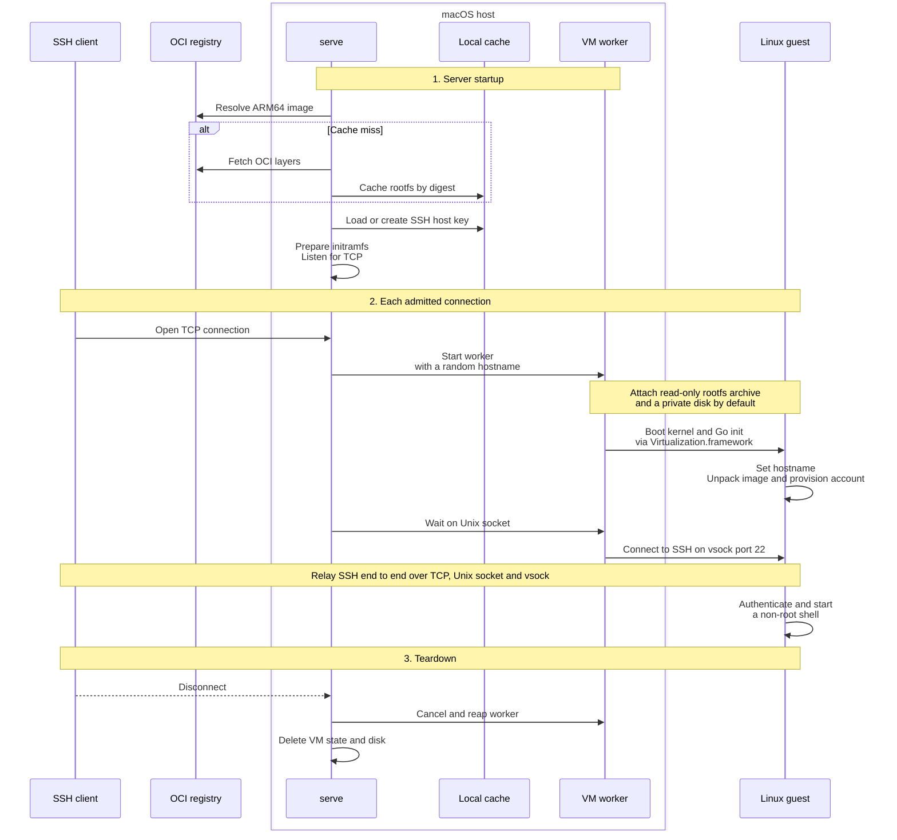

# SSH Container on Demand

Get a fresh Linux shell over SSH. On macOS, each admitted TCP connection boots a disposable ARM64 microVM from an OCI image, using Apple's Virtualization.framework directly. Disconnecting discards the guest and its writes. You don't need a container runtime, a guest OpenSSH server, or a Firecracker executable.

## Quick start

You'll need an Apple silicon Mac running macOS 13 or later, Go 1.25.7 or later, and Xcode or the Command Line Tools. The first build may download Go modules.

```sh
make
cp config.example.yaml config.yaml
```

`make` builds and embeds the Linux guest bootstrap, then signs the macOS binary with the virtualization entitlement. Edit [the example config](config.example.yaml) you copied to `config.yaml`:

- `microvm.image`: a Linux ARM64 OCI image with `/bin/sh`. The example uses Alpine. The image supplies the filesystem, not the Linux kernel; its entrypoint and command are not run.
- `microvm.ssh_public_key`: the path to one OpenSSH public key file. If you need a key, run `ssh-keygen -t ed25519`.
- `microvm.kernel.path`: the path to an uncompressed ARM64 Linux `Image`. The kernel needs built-in initramfs, virtio PCI, block, console and vsock, devtmpfs, tmpfs, procfs, sysfs and Unix PTY support. The default disk-backed root also needs built-in ext4.

The [Firecracker CI kernel](https://s3.amazonaws.com/spec.ccfc.min/firecracker-ci/20261125-454a9e84e707-0/aarch64/vmlinux-6.18.62) was tested on Apple silicon. It's a demonstration artifact, not a production kernel or an automatic download.

Start the service:

```sh
./ssh-container-on-demand --config config.yaml serve
```

In another terminal, connect with the matching private key. Verify the SSH host key against the fingerprint printed by `serve` before trusting it.

```sh
ssh -i "$HOME/.ssh/id_ed25519" -p 2222 shell@127.0.0.1
```

## How it works



- **Shared across guests:** `serve` resolves the image at startup and reuses a flattened archive by digest. The archive (limited to 1 GiB) and the stable SSH host key are stored under `~/Library/Caches/ssh-container-on-demand`. The initramfs is prepared for the current server run.
- **Private to each VM:** The guest unpacks the archive into a writable root filesystem. There is no guest NIC or host directory mount. The chroot includes read-only `/proc` and `/sys`, hides other users' processes with `hidepid=2`, and makes SSH terminals available under `/dev/pts`.
- **Deleted on disconnect or normal shutdown:** The worker and its VM are torn down, and the private disk file is removed. The host cache remains. SSH multiplexing reuses one TCP connection, so multiplexed sessions share one VM.

## Configuration

Set these optional values under `microvm:` in your config file:

| Setting | Default | What it controls |
| --- | --- | --- |
| `username` | `shell` | SSH login name and writable home directory (`/home/<username>`). |
| `uid` | `1000` | Non-root UID and primary GID. The guest provisions matching `/etc/passwd` and `/etc/group` entries. |
| `cpus` | `1` | vCPUs per VM. |
| `memory_mib` | `512` | RAM in MiB, assigned at boot. Use `0` to size it automatically for the selected root filesystem mode. |
| `disk_size_mib` | `1024` | Capacity in MiB of the private sparse ext4 disk. Use `0` for a RAM-backed writable root instead. |

The default login starts in `/home/shell`. If you set `username`, use that name in your SSH command. Each guest's hostname is picked from the [bundled Brazilian mythology list](internal/microvm/brazilian_mythology_names.txt), normalized for Linux and given a suffix to distinguish concurrent VMs, for example `pirarucu-2750431623`. This is the hostname you see inside the guest, not a new address to connect to.

A disk must be at least the flattened archive size plus 128 MiB and no larger than 64 GiB. Increase `disk_size_mib` for larger images. Automatic memory sizing happens only before boot; with a RAM-backed root, it increases the allocation for larger images.

`serve` listens on `127.0.0.1:2222` by default. Set `--listen` to change it, `--max-connections` to change the maximum number of concurrent guests (default `2`), or `--boot-timeout` to change how long it waits for guest SSH (default `30s`). Excess TCP connections are closed. Because a VM boots before the client's SSH key is checked, don't expose the listener directly to untrusted clients.

## Linux: planned Cloud Hypervisor backend

Serving SSH is currently supported only on macOS. The planned Linux backend is [Cloud Hypervisor](https://www.cloudhypervisor.org/docs/prologue/quick-start/) on a host with access to `/dev/kvm`. It will reuse the OCI cache, Go guest bootstrap, and per-connection cleanup, with [Cloud Hypervisor's vsock transport](https://github.com/cloud-hypervisor/cloud-hypervisor/blob/main/docs/vsock.md) to relay SSH to guest port 22.
